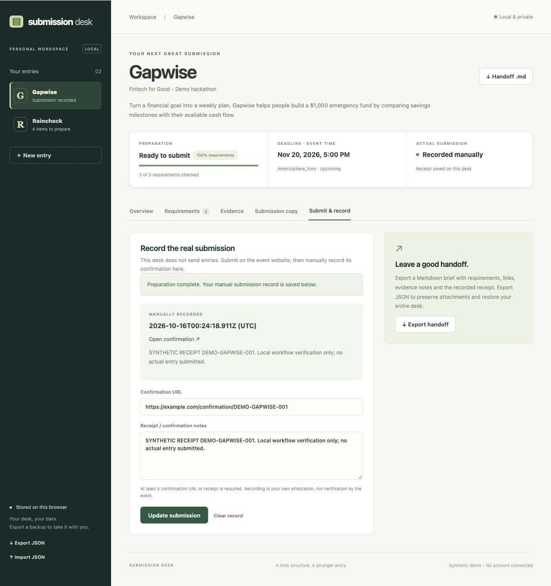
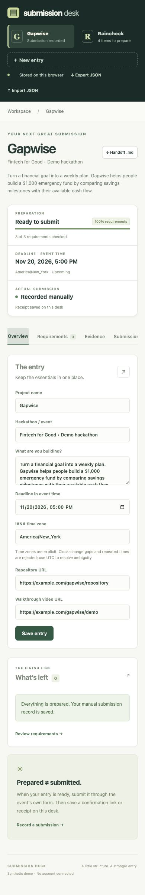

# A 90-second demo

This demo entry helps people reach a **financial goal: a $1,000 emergency fund**. No entry is sent to an organizer.

1. **0:00 — Meet the desk.** Start the app and choose Gapwise. Its deadline is November 20, 2026 at 5 PM in `America/New_York`. Review the synthetic financial-goal entry and the two unfinished items.
2. **0:15 — Prepare the entry.** Set the video to `https://example.com/gapwise/demo` and save. In Requirements, check the two-minute video requirement and save it. The entry is now ready, but actual submission is still **Not recorded**.
3. **0:30 — Back it up with evidence.** In Evidence, add “Walkthrough duration checked,” note the 1:54 duration and savings milestones, choose the video requirement and attach `docs/demo-evidence.txt`. Save. Download the file to inspect it.
4. **0:45 — Write the pitch.** Open Submission copy, edit the draft, save and use Copy saved text. The draft explains the $1,000 savings target, $250 starting balance and $50 weekly contribution.
5. **1:00 — Record what happened.** In Submit & record, enter `https://example.com/confirmation/DEMO-GAPWISE-001` and a clearly synthetic receipt. Record submission. The two statuses now independently show **Ready to submit** and **Recorded manually**.
6. **1:15 — Hand it off.** Export JSON and Handoff .md. Switch to Raincheck to see its independent work list. Import the JSON to restore the completed desk, including its evidence attachment and receipt. Refresh to confirm persistence.

For an instant finished example, import [completed-demo.json](completed-demo.json). It preserves the completed browser workflow, updated for the financial-goal correction and re-imported through the tested UI. [Gapwise-handoff.md](Gapwise-handoff.md) is the matching Markdown handoff. Import replaces the current desk after confirmation, so back up your own entries first.

